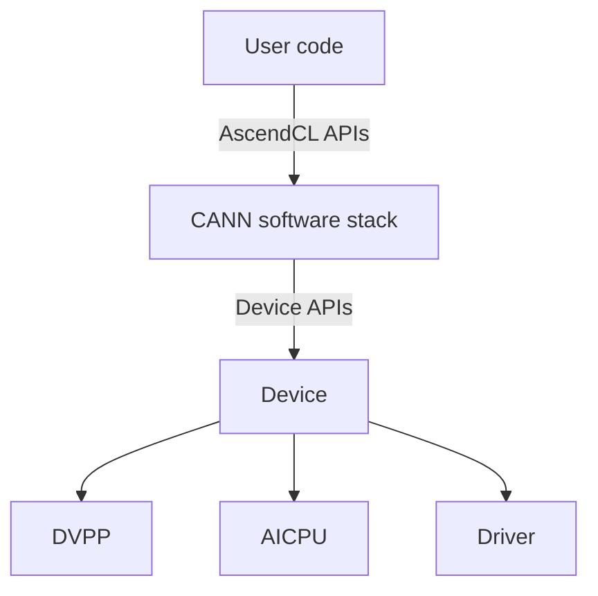

# Basic Cases

<br>

## 1. Checking the Ascend C Operator of the Kernel Launch Symbol

### 1.1 Procedure

1. Set related environment variables by referring to the [MindStudio Sanitizer Installation Guide](../install_guide/mssanitizer_install_guide.md).
2. Prepare for the check by referring to "Kernel Launch Symbol Scenario" in [Enabling Full Check](../user_guide/compile_option_config.md) in the MindStudio Sanitizer User Guide.
3. Build a single-operator executable file.

    The following is an example of the command for building an Add operator executable file.

    ```shell
    mkdir -p build && cd build && cmake .. && make
    ```

    After the one-click script building and running is complete, the NPU-side executable file `add` is generated in the project directory.

4. Use msSanitizer to start the executable file of a single-operator (`add` is used as an example).

    - Run the following command to perform memory check. For details about the options, see "Tool Overview" > "Command Summary" > "Common Options" and "Tool Overview" > "Command Summary" > "Memory Check Options" in the [MindStudio Sanitizer User Guide](../user_guide/mssanitizer_user_guide.md). For details about memory check, see [Memory Check Example](#12-memory-check-example).

    ```shell
    mssanitizer --tool=memcheck --log-level=error ./add   # Specify --tool=memcheck for memory check
    ```

    - Run the following command for race check. For details about the options, see "Tool Overview" > "Command Summary" > "Common Options" in the [MindStudio Sanitizer User Guide](../user_guide/mssanitizer_user_guide.md). For details about race check, see [Race Check Example](#13-race-check-example).

    ```shell
    mssanitizer --tool=racecheck --log-level=error ./add   # Specify --tool=racecheck for race check
    ```

    The path of the single-operator executable file can be set to either an absolute path or a relative path according to the actual situation.

### 1.2 Memory Check Example

- Before this [Procedure](#11-procedure), construct an invalid read/write scenario in the Add operator and change the length of `DataCopy` from `TILE_LENGTH` to 2 × `TILE_LENGTH`. In this case, memory overwriting occurs during the last copy.
- According to the report generated by the check tool, 480-byte invalid write operations are performed on the GM in line 81 of the `add.asc` file, which corresponds to the constructed abnormal scenario.

### 1.3 Race Check Example

- Before this [Procedure](#11-procedure), construct an inter-core race scenario in the Add operator and change the length of `DataCopy` from `TILE_LENGTH` to 2 × `TILE_LENGTH`. In this case, inter-core race exists in the GM.
- According to the report generated by the check tool, in line 81 of `add.asc`, inter-core race occurs between cores 0 and 1 of the AIV, corresponding to the constructed exception scenario.

## 2. Checking the API-Called Single-Operator

After the custom operator is developed and deployed, use the single-operator API to call the operator, add check-related compilation options, rebuild and deploy the operator, and use msSanitizer to run the executable file to check exceptions of the operator.

### 2.1 Prerequisites

Click [custom_op_04 Sample Code](https://gitcode.com/cann/cann-learning-hub/tree/8.5.0/tutorials/ascendc_operator_development/03_intermediate_vector_operator_development/src/custom_op_04) to obtain the sample project to prepare for operator check.

> [!NOTE]
>
> This sample project is configured for Atlas A2 products by default. To use products of another series, modify the following two default configurations:
>
> 1. `ASCEND_COMPUTE_UNIT` in the `CMakeLists.txt` file in the root directory defaults to `ascend910b`. Change it according to the actual chip model (query the Chip Name by running `npu-smi info`). For example, for Atlas 950PR/950DT products, change it to `ascend950`.
> 2. The value of `.AddConfig("ascend910b")` in `add_custom_template.cpp` in the `op_host` directory must be modified in the same way.
>
> When downloading the code sample, run the following command to specify the branch version:
>
> ```shell
> git clone https://gitcode.com/cann/cann-learning-hub.git -b 8.5.0
> ```

### 2.2 Procedure

1. Compile and deploy the operator by referring to "Operator Compilation and Deployment" in the [msOpGen User Guide](https://gitcode.com/Ascend/msopgen/blob/master/docs/en/user_guide/msopgen_user_guide.md).

    > [!NOTE]
    >
    > In the `${git_clone_path}/cann-learning-hub/tutorials/ascendc_operator_development/03_intermediate_vector_operator_development/src/custom_op_04` directory of the sample project, modify the `op_kernel/CMakeLists.txt` file and add the `-sanitizer` option to the kernel implementation to support the check function.
    >
    > ```cmake
    > npu_op_kernel_options(ascendc_kernels ALL OPTIONS -sanitizer)
    > ```
    >

2. Click [Prerequisites](#21-prerequisites) to obtain the sample project directory for verifying the code.

    ```text
    test/
    ├── CMakeLists.txt    // Build rules file
    ├── main.cpp          // Entry for single-operator execution
    ├── run.sh            // Build and run script
    ```

3. Use the check tool to start the operator API running script.

    ```shell
      mssanitizer --tool=memcheck --log-level=error bash run.sh  # Specify --tool=memcheck for memory check
      mssanitizer --tool=racecheck --log-level=error bash run.sh # Specify --tool=racecheck for race check
    ```

4. Analyze abnormal behavior by referring to "Memory Check" > "Interpreting a Memory Exception Report", "Race Check" > "Interpreting a Race Exception Report", and "Uninitialization Check" > "Interpreting an Uninitialized Memory Exception Report" in the [MindStudio Sanitizer User Guide](../user_guide/mssanitizer_user_guide.md).

## 3. Checking the Operators Called by a PyTorch API

### 3.1 Prerequisites

- Click [kernel_pytorch_call Sample Code](https://gitcode.com/cann/cann-learning-hub/tree/6dfac1dad4b8eb9a3cd08322c76f98039480ea31/tutorials/ascendc_operator_development_light/02_AscendC_basic/src/02.06/kernel_pytorch_call) to obtain the sample project to prepare for operator check.

> [!NOTE]
>
> - When downloading the code sample, run the following command to specify the branch version:
>
> ```shell
> git clone https://gitcode.com/cann/cann-learning-hub.git && cd cann-learning-hub && git checkout 6dfac1dad4b8
> ```

- You have installed the PyTorch framework and TorchNPU plugin by referring to [TorchNPU Software Installation](https://gitcode.com/Ascend/pytorch/blob/v2.7.1-26.1.0/docs/en/installation_guide/installation_description.md).

### 3.2 Procedure

1. Go to the sample directory. This sample uses the `torch.library` mechanism to register the `add_custom` kernel as a PyTorch custom operator.

    ```bash
    cd ${git_clone_path}/cann-learning-hub/tutorials/ascendc_operator_development_light/02_AscendC_basic/src/02.06/kernel_pytorch_call/torch_library
    ```

    > [!NOTE]
    >
    > The sample project directory of the PyTorch integration project is as follows:
    >
    > ```text
    > torch_library
    > ├── CMakeLists.txt        // Build project file
    > ├── torch_binding.cpp     // torch.library encapsulation and operator registration
    > ├── add_custom_test.py    // PyTorch calling and precision verification script
    > └── README.md             // Sample description document
    > ```
    >
    > The kernel implementation is located in the upper-level directory `../common/add_custom.asc`.

2. Compile the operator code by adding the following compilation options:

    - `-g`
    - `--cce-enable-sanitizer` or `--sanitizer`

    Edit the `CMakeLists.txt` file in the sample project directory and refer to the complete sample of kernel function development and running verification. Select the `npu-arch` parameter corresponding to the deployed NPU hardware architecture. This parameter is specified by the `CMAKE_ASC_ARCHITECTURES` variable. For example, for Atlas 950PR/950DT products, change the variable to `dav-3510`. The value `dav-2201` in this sample applies to Ascend A2/A3 products.

    ```cmake
    target_compile_options(ascendc_kernels PRIVATE
        $<$<COMPILE_LANGUAGE:ASC>:--npu-arch=${CMAKE_ASC_ARCHITECTURES} --cce-enable-sanitizer -g>
    )
    ```

    Adding the `--cce-enable-sanitizer` or `--sanitizer` option enables exception check. The two options are completely equivalent, and you can use either of them.

    The `-g` option makes the compiler generate location information. When the tool outputs an exception report, it prints the specific location where the exception occurs (file name, line number, call stack, and so on).

    > [!NOTE]
    >
    > - When `--cce-enable-sanitizer` and `-O0` are enabled at the same time, you need to add the `--cce-ignore-always-inline=false` compilation option.
    > - Adding the `-g` compilation option attaches debugging information to the generated binary file. You are advised to restrict access to user programs that contain debugging information and ensure that only authorized personnel can access the binary file.
    > - Operator binaries generated with the `--cce-enable-sanitizer` compilation option must be used together with the msSanitizer tool. You are advised not to use such binaries separately, as doing so may cause unforeseen problems.
    > - Due to the limitations of the **llvm-symbolizer** open-source software, the tool may fail to obtain the call stack exception information. In this case, run the check command again to obtain the call stack exception information.

3. Run the following commands to compile the operator and generate the dynamic library.

    ```bash
    source ${install_path}/cann/set_env.sh
    mkdir -p build && cd build
    cmake -DCMAKE_ASC_ARCHITECTURES=dav-2201 ..
    make -j
    ```

    After the compilation is complete, `libascendc_kernels.so` and `libascendc_ops.so` are generated in the build directory.

4. Start the msSanitizer tool to start the Python program for exception check. For details about how to enable the exception check function, see "Tool Overview" > "Principles for Enabling the Exception Check Function" in the [MindStudio Sanitizer User Guide](../user_guide/mssanitizer_user_guide.md).
5. Analyze abnormal behavior by referring to "Memory Check" > "Interpreting a Memory Exception Report", "Race Check" > "Interpreting a Race Exception Report", and "Uninitialization Check" > "Interpreting an Uninitialized Memory Exception Report" in the [MindStudio Sanitizer User Guide](../user_guide/mssanitizer_user_guide.md).

## 4. Checking the Triton Operator

### 4.1 Prerequisites

- The Triton and Triton-Ascend plugin have been installed and configured by referring to [triton-ascend repository](https://gitcode.com/Ascend/triton-ascend).
- Enable the following environment variables to turn on the exception check function for Triton operators.

    ```sh
    # Enable exception check
    export TRITON_ENABLE_SANITIZER=1

    # Force operator recompilation so that exception check takes effect
    export TRITON_ALWAYS_COMPILE=1
    ```

- You have prepared the implementation file of the Triton operator.

    If you have not prepared the Triton operator, refer to the following example. This section describes the check process of the Triton operator based on this example.

    ```py
    # File name: sample.py
    import triton
    import triton.language as tl
    import torch

    def torch_pointwise(x0, x1):
        res = x0 + x1
        return res


    @triton.jit
    def triton_add(in_ptr0, in_ptr1, out_ptr0, XBLOCK: tl.constexpr, XBLOCK_SUB: tl.constexpr):
        offset = tl.program_id(0) * XBLOCK
        base1 = tl.arange(0, XBLOCK_SUB)
        loops1: tl.constexpr = (XBLOCK + XBLOCK_SUB - 1) // XBLOCK_SUB
        for loop1 in range(loops1):
            x0 = offset + (loop1 * XBLOCK_SUB) + base1
            tmp0 = tl.load(in_ptr0 + (x0), None)
            tmp1 = tl.load(in_ptr1 + (x0), None)
            tmp2 = tmp0 + tmp1
            tl.store(out_ptr0 + (x0), tmp2, None)


    def test_case(dtype, shape, ncore, xblock, xblock_sub):
        x0 = torch.randn(shape, dtype=dtype).npu()
        x1 = torch.randn(shape, dtype=dtype).npu()
        y_ref = torch_pointwise(x0, x1)
        y_cal = torch.zeros(shape, dtype=dtype).npu()
        triton_add[ncore, 1, 1](x0, x1, y_cal, xblock, xblock_sub)
        print("Pass" if torch.equal(y_ref, y_cal) else "Failed")


    if __name__ == "__main__":
        test_case(torch.float32, (2, 4096, 8), 2, 32768, 1024)
    ```

### 4.2 Procedure

1. Prepare for the check by referring to "Triton Operator Calling Scenario" in [Enabling Full Check](../user_guide/compile_option_config.md).
2. Disable the memory pool.
    In the sample, PyTorch is used to create tensors. In the PyTorch framework, the GM is managed in memory pool mode by default, which interferes with memory check. Therefore, you need to set the following environment variable to disable the memory pool before the check to ensure that the check result is accurate.

    ```sh
    export PYTORCH_NO_NPU_MEMORY_CACHING=1
    ```

3. Construct an illegal read/write scenario within the Triton operator. Shift the first loaded memory rightward by 100 elements, thereby causing an illegal read on GM during the load operation.

    ```python
      def triton_add(in_ptr0, in_ptr1, out_ptr0, XBLOCK: tl.constexpr, XBLOCK_SUB: tl.constexpr):
          offset = tl.program_id(0) * XBLOCK
          base1 = tl.arange(0, XBLOCK_SUB)
          loops1: tl.constexpr = (XBLOCK + XBLOCK_SUB - 1) // XBLOCK_SUB
          for loop1 in range(loops1):
              x0 = offset + (loop1 * XBLOCK_SUB) + base1
              # ERROR: Construct an illegal read exception
              tmp0 = tl.load(in_ptr0 + (x0) + 100, None)
              tmp1 = tl.load(in_ptr1 + (x0), None)
    ```

4. Use the msSanitizer tool to start the Triton operator. For details about the options, see "Tool Overview" > "Command Summary" > "Common Options" and "Tool Overview" > "Command Summary" > "Memory Check Options" in the [MindStudio Sanitizer User Guide](../user_guide/mssanitizer_user_guide.md). For details about memory check, see "Memory Check" in the [MindStudio Sanitizer User Guide](../user_guide/mssanitizer_user_guide.md).

    ```shell
      mssanitizer --tool=memcheck --log-level=error -- python sample.py # Specify --log-level=error to output only ERROR-level messages, preventing WARNING messages from flooding the screen
    ```

### 4.3 Memory Exception Report Example

According to the report generated by the check tool, an illegal read of 368 Bytes is performed on the GM in line 18 of `sample.py`, which is consistent with the constructed exception scenario.

```text
$ mssanitizer -t memcheck -- python sample.py
[mssanitizer] logging to file: ./mindstudio_sanitizer_log/mssanitizer_20250522093805_922880.log
Failed
====== ERROR: illegal read of size 368
======    at 0x12c0c0053190 on GM in triton_add
======    in block aiv(1) on device 0
======    code in pc current 0x1b0 (serialNo:524)
======    #0 sample.py:18:45
```

## 5. Checking the Memory of the CANN Software Stack

For scenarios where memory exceptions may occur when user programs call CANN software stack APIs, the msSanitizer tool provides the memory check capability for device APIs and AscendCL APIs, allowing users to identify memory exceptions.

### 5.1 Principles of Memory Leak Check

When the device memory queried by running the `npu-smi info` command keeps increasing, you can use this tool to identify memory leak. If memory leak occurs on AscendCL APIs, you can identify the code line.

As shown in the following figure, the CANN software stack memory operation APIs consist of two levels: the lower device APIs provided by the driver and the upper AscendCL APIs for user code to call.



To identify a memory leak, perform the following steps:

1. Enable leak check for device APIs to determine whether memory leak occurs on the host. If no, the leak occurs on the device. If yes, go to the next step to check whether AscendCL API call leak occurs.
2. Enable leak check for AscendCL APIs to determine whether leak occurs when user code calls AscendCL APIs. If no, the problem is not caused by AscendCL API calls. If yes, go to the next step to identify the specific code line.
3. Use the new APIs provided by the msSanitizer tool to recompile the header file, and then use the tool to start the check program to identify the file name and code line number corresponding to the allocation function whose allocations are not destroyed. For details about the new APIs, see [MindStudio Sanitizer API Reference](../api_reference/mssanitizer_api_reference.md).

### 5.2 Troubleshooting Procedure

1. Set related environment variables by referring to the [MindStudio Sanitizer Installation Guide](../install_guide/mssanitizer_install_guide.md).
2. Check whether memory leak occurs on the host.

    1. Use the msSanitizer tool to start the program to be checked. The following is a command example:

        ```shell
          mssanitizer --check-device-heap=yes --leak-check=yes ./add_npu
        ```

        The path of the program to be checked (for example, `*_add_custom_npu_*`) can be set to either an absolute path or a relative path according to the actual situation.

    2. If no exception information is displayed, the check program is running properly and no memory leak occurs on the host. If the following exception information is displayed, memory leak occurs on the host.

        The following command output indicates that one memory allocation on the host is not destroyed, resulting in a 32800-byte memory leak.

        ```text
        ====== ERROR: LeakCheck: detected memory leaks

        ======    Direct leak of 32800 byte(s)
        ======      at 0x124080024000 on GM allocated in <unknown>:0 (serialNo:0)

        ====== SUMMARY: 32800 byte(s) leaked in 1 allocation(s)
        ```

3. Determine whether the memory leak is caused by AscendCL API calls.

    1. Use the msSanitizer tool to start the program to be checked. The following is a command example:

          ```shell
            mssanitizer --check-cann-heap=yes --leak-check=yes ./add_npu
          ```

    2. If no exception information is displayed, the check program is running successfully and no memory leak occurs during the AscendCL API calls. If the following exception information is displayed, memory leak occurs during the AscendCL API calls.

        The following information indicates that one memory allocation is not destroyed when the AscendCL API is called, resulting in a 32768-byte memory leak.

          ```text
          ====== ERROR: LeakCheck: detected memory leaks

          ======    Direct leak of 32768 byte(s)
          ======      at 0x124080024000 on GM allocated in <unknown>:0 (serialNo:0)

          ====== SUMMARY: 32768 byte(s) leaked in 1 allocation(s)
          ```
