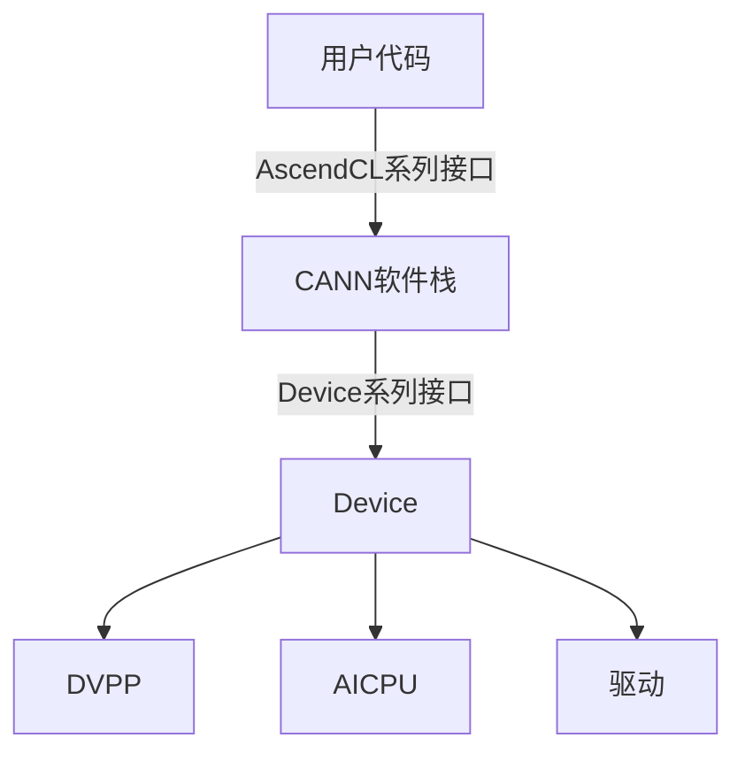

# 基础案例

<br>

## 1. 检测内核调用符方式的Ascend C算子

### 1.1 操作步骤

1. 参考《[MindStudio Sanitizer 安装指南](../install_guide/mssanitizer_install_guide.md)》完成相关环境变量的配置。
2. 请参考《[开启全量检测](../user_guide/compile_option_config.md)》中的“内核调用符场景”，完成使用前准备。
3. 构建单算子可执行文件。

    以Add算子为例，可执行文件的构建命令示例如下：

    ```shell
    mkdir -p build && cd build && cmake .. && make
    ```

    一键式编译运行脚本完成后，在工程目录下生成NPU侧可执行文件`add`。

4. 使用msSanitizer检测工具拉起单算子可执行文件（以add为例）。

    - 内存检测执行以下命令，具体参数说明请参考《[MindStudio Sanitizer 使用指南](../user_guide/mssanitizer_user_guide.md)》中的“命令与参数参考>参数汇总>通用参数说明表”和《[MindStudio Sanitizer 使用指南](../user_guide/mssanitizer_user_guide.md)》中的“命令与参数参考>参数汇总>内存检测参数说明表”，内存检测请参考[内存检测示例说明](#12-内存检测示例说明)。

    ```shell
    mssanitizer --tool=memcheck --log-level=error ./add   # 内存检测需指定 --tool=memcheck
    ```

    - 竞争检测执行以下命令，具体参数说明请参考《[MindStudio Sanitizer 使用指南](../user_guide/mssanitizer_user_guide.md)》中的“命令与参数参考>参数汇总>通用参数说明表”，竞争检测请参考[竞争检测示例说明](#13-竞争检测示例说明)。

    ```shell
    mssanitizer --tool=racecheck --log-level=error ./add   # 竞争检测需指定 --tool=racecheck
    ```

    单算子可执行文件所在路径可配置为绝对路径或相对路径，请根据实际环境配置。

### 1.2 内存检测示例说明

- 在[操作步骤](#11-操作步骤)之前，需要在Add算子中构造一个非法读写的场景，将DataCopy内存拷贝长度从TILE_LENGTH改为2 * TILE_LENGTH，此时最后一次拷贝会发生内存读写越界。
- 根据检测工具输出的报告，可以发现在**add.asc**的81行对GM存在480字节的非法写操作，与我们构造的异常场景对应。

### 1.3 竞争检测示例说明

- 在[操作步骤](#11-操作步骤)之前，需要在Add算子中构造一个核间竞争的场景，将DataCopy内存拷贝长度从TILE_LENGTH改为2 * TILE_LENGTH，此时会在GM内存上存在核间竞争。
- 根据检测工具输出的报告，可以发现在**add.asc**的81行，AIV的0核和1核存在核间竞争，符合我们构造的异常场景。

## 2. 检测API调用的单算子

完成自定义算子的开发部署后，通过单算子API执行的方式调用，添加检测相关编译选项重新编译算子并部署，使用msSanitizer工具运行可执行文件实现算子进行异常检测。

### 2.1 前提条件

单击[custom_op_04示例代码](https://gitcode.com/cann/cann-learning-hub/tree/8.5.0/tutorials/ascendc_operator_development/03_intermediate_vector_operator_development/src/custom_op_04)获取样例工程，为进行算子检测做准备。

> [!NOTE]
>
> 此样例工程默认按 Atlas A2 系列产品配置。若使用其他系列产品，需修改以下两处默认配置：
>
> 1. 根目录 `CMakeLists.txt` 中 `ASCEND_COMPUTE_UNIT` 默认为 `ascend910b`，请根据实际芯片型号（通过 `npu-smi info` 查询 Chip Name）修改。例如 Atlas 950PR&950DT 系列产品需改为 `ascend950`。
> 2. `op_host` 目录下 `add_custom_template.cpp` 中 `.AddConfig("ascend910b")` 的值需要同样修改。
>
> 下载代码样例时，需执行以下命令指定分支版本：
>
> ```shell
> git clone https://gitcode.com/cann/cann-learning-hub.git -b 8.5.0
> ```

### 2.2 操作步骤

1. 请参考《[MindStudio Ops Generator工具用户指南](https://gitcode.com/Ascend/msopgen/blob/master/docs/zh/user_guide/msopgen_user_guide.md)》中的“算子编译部署”章节，完成算子的编译部署。

    > [!NOTE]
    >
    > 在样例工程的`${git_clone_path}/cann-learning-hub/tutorials/ascendc_operator_development/03_intermediate_vector_operator_development/src/custom_op_04`目录下，修改在op_kernel/CMakeLists.txt文件，在Kernel侧实现中增加检测选项-sanitizer，以支持检测功能
    >
    > ```cmake
    > npu_op_kernel_options(ascendc_kernels ALL OPTIONS -sanitizer)
    > ```
    >

2. 单击[前提条件](#21-前提条件)，获取验证代码的样例工程目录。

    ```text
    test/
    ├── CMakeLists.txt    // 编译规则文件
    ├── main.cpp          // 单算子调用应用的入口
    ├── run.sh            // 编译运行脚本
    ```

3. 使用检测工具拉起算子API运行脚本。

    ```shell
      mssanitizer --tool=memcheck --log-level=error bash run.sh  # 内存检测需指定 --tool=memcheck
      mssanitizer --tool=racecheck --log-level=error bash run.sh # 竞争检测需指定 --tool=racecheck
    ```

4. 参考《[MindStudio Sanitizer 使用指南](../user_guide/mssanitizer_user_guide.md)》中的“内存检测>内存异常报告解析”、“竞争检测>竞争异常报告解析”及“未初始化检测>未初始化异常报告解析”分析异常行为。

## 3. 检测PyTorch接口调用的算子

### 3.1 前提条件

- 单击[kernel_pytorch_call示例代码](https://gitcode.com/cann/cann-learning-hub/tree/6dfac1dad4b8eb9a3cd08322c76f98039480ea31/tutorials/ascendc_operator_development_light/02_AscendC_basic/src/02.06/kernel_pytorch_call)获取样例工程，为进行算子检测做准备。

> [!NOTE]
>
> - 下载代码样例时，需执行以下命令指定分支版本。
>
> ```shell
> git clone https://gitcode.com/cann/cann-learning-hub.git && cd cann-learning-hub && git checkout 6dfac1dad4b8
> ```

- 已参考《[TorchNPU软件安装](https://gitcode.com/Ascend/pytorch/blob/v2.7.1-26.1.0/docs/zh/installation_guide/installation_description.md)》，完成PyTorch框架和TorchNPU插件的安装。

### 3.2 操作步骤

1. 进入到样例目录，该样例使用torch.library机制将add_custom Kernel注册为PyTorch自定义算子。

    ```bash
    cd ${git_clone_path}/cann-learning-hub/tutorials/ascendc_operator_development_light/02_AscendC_basic/src/02.06/kernel_pytorch_call/torch_library
    ```

    > [!NOTE]
    >
    > PyTorch接入工程的样例工程目录如下：
    >
    > ```text
    > torch_library
    > ├── CMakeLists.txt        // 编译工程文件
    > ├── torch_binding.cpp     // torch.library封装与算子注册
    > ├── add_custom_test.py    // PyTorch调用与精度校验脚本
    > └── README.md             // 样例说明文档
    > ```
    >
    > Kernel实现位于上级目录 `../common/add_custom.asc`。

2. 进行算子代码编译，需添加以下编译选项：

    - -g
    - --cce-enable-sanitizer或--sanitizer

    编辑样例工程目录下的“CMakeLists.txt”文件，参考核函数开发和运行验证的完整样例。请根据实际部署的 NPU 硬件架构选择对应的 `npu-arch` 参数，该参数由变量 `CMAKE_ASC_ARCHITECTURES` 指定。例如，Atlas 950PR&950DT 系列产品需将该变量改为 `dav-3510`；本样例中的值 `dav-2201` 适用于昇腾 A2/A3 系列产品。

    ```cmake
    target_compile_options(ascendc_kernels PRIVATE
        $<$<COMPILE_LANGUAGE:ASC>:--npu-arch=${CMAKE_ASC_ARCHITECTURES} --cce-enable-sanitizer -g>
    )
    ```

    增加--cce-enable-sanitizer或--sanitizer选项代表使能异常检测，两个选项完全等价，可随意使用其一。

    增加-g选项使编译器生成定位信息，将会在异常报告输出时打印异常发生的具体位置（文件名、行号以及调用栈等信息）。

    > [!NOTE]
    >
    > - --cce-enable-sanitizer和-O0同时开启的情况下，需要增加编译选项 --cce-ignore-always-inline=false。
    > - 添加-g编译选项会在生成的二进制文件中附带调试信息，建议限制带有调试信息的用户程序的访问权限，确保只有授权人员可以访问该二进制文件。
    > - 增加--cce-enable-sanitizer编译选项生成的算子二进制，需与msSanitizer工具配套使用。不建议单独使用该二进制，单独使用可能会导致不可预见的问题。
    > - 因**llvm-symbolizer**开源软件限制，调用栈的异常信息可能会获取失败。此时，用户可再次执行检测命令，就可以获取调用栈的异常信息。

3. 执行以下命令，编译算子并生成动态库。

    ```bash
    source ${install_path}/cann/set_env.sh
    mkdir -p build && cd build
    cmake -DCMAKE_ASC_ARCHITECTURES=dav-2201 ..
    make -j
    ```

    编译完成后，在build目录下生成`libascendc_kernels.so`和`libascendc_ops.so`。

4. 启动msSanitizer工具拉起Python程序，进行异常检测，异常检测功能的开启原则请参见《[MindStudio Sanitizer 使用指南](../user_guide/mssanitizer_user_guide.md)》中的“检测功能组合规则”。
5. 参考《[MindStudio Sanitizer 使用指南](../user_guide/mssanitizer_user_guide.md)》中的“内存检测>内存异常报告解析”、“竞争检测>竞争异常报告解析”及“未初始化检测>未初始化异常报告解析”分析异常行为。

## 4. 检测Triton算子

### 4.1 前提条件

- 参考[triton-ascend仓](https://gitcode.com/Ascend/triton-ascend)，完成Triton及Triton-Ascend插件的安装和配置。
- 打开以下环境变量，使能 Triton 算子异常检测功能：

    ```sh
    # 开启异常检测
    export TRITON_ENABLE_SANITIZER=1

    # 强制算子重新编译，使异常检测生效
    export TRITON_ALWAYS_COMPILE=1
    ```

- 自备Triton算子实现文件。

    若用户尚未准备Triton算子，可参考以下示例。本节将基于此示例来说明Triton算子的检测流程。

    ```py
    # file name: sample.py
    import triton
    import triton.language as tl
    import torch

    def torch_pointwise(x0, x1):
        res = x0 + x1
        return res


    @triton.jit
    def triton_add(in_ptr0, in_ptr1, out_ptr0, XBLOCK: tl.constexpr, XBLOCK_SUB: tl.constexpr):
        offset = tl.program_id(0) * XBLOCK
        base1 = tl.arange(0, XBLOCK_SUB)
        loops1: tl.constexpr = (XBLOCK + XBLOCK_SUB - 1) // XBLOCK_SUB
        for loop1 in range(loops1):
            x0 = offset + (loop1 * XBLOCK_SUB) + base1
            tmp0 = tl.load(in_ptr0 + (x0), None)
            tmp1 = tl.load(in_ptr1 + (x0), None)
            tmp2 = tmp0 + tmp1
            tl.store(out_ptr0 + (x0), tmp2, None)


    def test_case(dtype, shape, ncore, xblock, xblock_sub):
        x0 = torch.randn(shape, dtype=dtype).npu()
        x1 = torch.randn(shape, dtype=dtype).npu()
        y_ref = torch_pointwise(x0, x1)
        y_cal = torch.zeros(shape, dtype=dtype).npu()
        triton_add[ncore, 1, 1](x0, x1, y_cal, xblock, xblock_sub)
        print("Pass" if torch.equal(y_ref, y_cal) else "Failed")


    if __name__ == "__main__":
        test_case(torch.float32, (2, 4096, 8), 2, 32768, 1024)
    ```

### 4.2 操作步骤

1. 请参考《[开启全量检测](../user_guide/compile_option_config.md)》中的“Triton算子调用场景”，完成使用前准备。
2. 关闭内存池。
    样例中使用PyTorch创建Tensor，PyTorch框架内默认使用内存池的方式管理GM内存，会对内存检测产生干扰。因此，在检测前需要额外设置如下环境变量关闭内存池，以保证检测结果准确。

    ```sh
    export PYTORCH_NO_NPU_MEMORY_CACHING=1
    ```

3. 在Triton算子中构造一个非法读写的场景，将第一次load的内存向右偏移100个元素，此时会导致load在GM内存上发生非法读。

    ```python
      def triton_add(in_ptr0, in_ptr1, out_ptr0, XBLOCK: tl.constexpr, XBLOCK_SUB: tl.constexpr):
          offset = tl.program_id(0) * XBLOCK
          base1 = tl.arange(0, XBLOCK_SUB)
          loops1: tl.constexpr = (XBLOCK + XBLOCK_SUB - 1) // XBLOCK_SUB
          for loop1 in range(loops1):
              x0 = offset + (loop1 * XBLOCK_SUB) + base1
              # ERROR: 构造非法读异常
              tmp0 = tl.load(in_ptr0 + (x0) + 100, None)
              tmp1 = tl.load(in_ptr1 + (x0), None)
    ```

4. 使用msSanitizer检测工具拉起Triton算子。具体参数说明请参考《[MindStudio Sanitizer 使用指南](../user_guide/mssanitizer_user_guide.md)》中的“命令与参数参考>参数列表>通用参数说明表”和《[MindStudio Sanitizer 使用指南](../user_guide/mssanitizer_user_guide.md)》中的“命令与参数参考>参数列表>内存检测参数说明表”，内存检测请参考《[MindStudio Sanitizer 使用指南](../user_guide/mssanitizer_user_guide.md)》中的“内存检测”。

    ```shell
      mssanitizer --tool=memcheck --log-level=error -- python sample.py # --log-level=error 只输出 ERROR 级别告警，防止 WARNING 级别刷屏影响使用
    ```

### 4.3 内存异常报告示例

根据检测工具输出的报告，可以发现在sample.py的18行对GM存在368字节的非法读操作，与构造的异常场景一致。

```text
$ mssanitizer -t memcheck -- python sample.py
[mssanitizer] logging to file: ./mindstudio_sanitizer_log/mssanitizer_20250522093805_922880.log
Failed
====== ERROR: illegal read of size 368
======    at 0x12c0c0053190 on GM in triton_add
======    in block aiv(1) on device 0
======    code in pc current 0x1b0 (serialNo:524)
======    #0 sample.py:18:45
```

## 5. 检测CANN软件栈的内存

针对用户程序调用CANN软件栈接口可能出现的内存异常操作场景，msSanitizer检测工具提供了Device相关接口和AscendCL相关接口的内存检测能力，方便用户对程序内存异常操作位置的排查和定位。

### 5.1 内存泄漏检测使用原理

当**npu-smi info**命令查询到的设备内存不断增大时，可使用本工具进行内存泄漏定位定界，若AscendCL系列接口泄漏可支持定位到代码行。

如下图所示，CANN软件栈内存操作接口包含两个层级，向下使用驱动侧提供的Device侧接口，向上提供了AscendCL系列接口供用户代码调用。



内存泄漏定位可分为以下步骤：

1. 使能Device系列接口进行泄漏检测，判断内存泄漏是否发生在Host侧。若没有，则定界到Device侧的应用出现泄漏；若有，则通过下一个步骤判断AscendCL接口调用是否发生泄漏；
2. 使能AscendCL系列接口进行泄漏检测，判断用户代码调用AscendCL接口是否存在泄漏。若没有，则定界为非AscendCL接口调用问题；如果出现泄漏，则通过下一步定位到具体代码行；
3. 使用msSanitizer检测工具中提供的新接口，对头文件重新编译，再用检测工具拉起检测程序，可定位到未释放内存的分配函数所对应的文件名与代码行号。新接口的详细说明请参见《[MindStudio Sanitizer 对外接口使用说明](../api_reference/mssanitizer_api_reference.md)》。

### 5.2 排查步骤

1. 参考《[MindStudio Sanitizer 安装指南](../install_guide/mssanitizer_install_guide.md)》完成相关环境变量的配置。
2. 定界是否为Host侧泄漏。

    1. 使用msSanitizer检测工具拉起待检测程序，命令示例如下：

        ```shell
          mssanitizer --check-device-heap=yes --leak-check=yes ./add_npu
        ```

        待检测程序（以_add_custom_npu_为例）所在路径可配置为绝对路径或相对路径，请根据实际环境配置。

    2. 若无异常输出则说明检测程序运行成功，且Host侧不存在内存泄漏情况；若输出如下错误说明Host侧的应用出现了内存泄漏。

        以下输出结果表明Host侧共有一处分配了内存但未释放，导致内存泄漏32800字节。

        ```text
        ====== ERROR: LeakCheck: detected memory leaks

        ======    Direct leak of 32800 byte(s)
        ======      at 0x124080024000 on GM allocated in <unknown>:0 (serialNo:0)

        ====== SUMMARY: 32800 byte(s) leaked in 1 allocation(s)
        ```

3. 定界是否为AscendCL接口调用导致泄漏。

    1. 使用msSanitizer检测工具拉起待检测程序，命令示例如下：

          ```shell
            mssanitizer --check-cann-heap=yes --leak-check=yes ./add_npu
          ```

    2. 若无异常输出则说明检测程序运行成功，且AscendCL接口调用不存在内存泄漏情况；若输出如下错误说明AscendCL接口调用出现了内存泄漏。

        以下输出结果表明调用AscendCL接口时共有一处分配了内存但未释放，导致内存泄漏32768字节。

          ```text
          ====== ERROR: LeakCheck: detected memory leaks

          ======    Direct leak of 32768 byte(s)
          ======      at 0x124080024000 on GM allocated in <unknown>:0 (serialNo:0)

          ====== SUMMARY: 32768 byte(s) leaked in 1 allocation(s)
          ```
